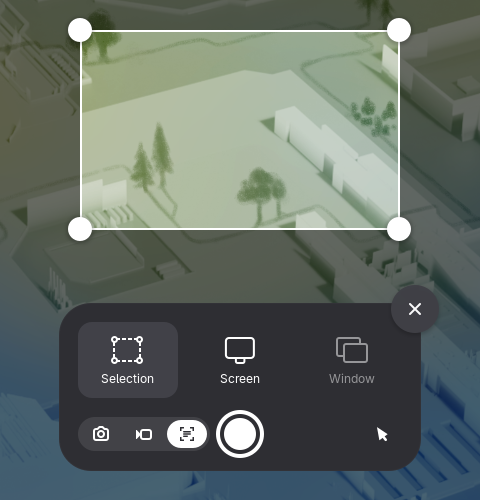

# Screenshot Scan

A GNOME Shell extension that reads **text, QR codes and barcodes** straight
from GNOME's built-in screenshot tool.

Press **Print Screen**, click the new **Scan** button (next to the camera and
video buttons), and capture an area, a window or the screen. The QR/barcode
contents, or the text if there are no codes, are copied to your clipboard.
No screenshot file is saved, and everything runs on your computer with no
network access.



You can change what gets copied (codes only, text only, or both) and the OCR
languages in the extension's preferences.

## Install (Fedora, GNOME 50/51)

First install the scanning tools:

```
sudo dnf install zbar tesseract tesseract-langpack-eng
```

Then install the extension in one of these ways:

- **From GNOME Extensions:**
  [extensions.gnome.org/extension/11869/screenshot-scan](https://extensions.gnome.org/extension/11869/screenshot-scan/).
- **From a release zip:** download `screenshot-scan@awikman-bot.github.io.shell-extension.zip`
  from the [latest release](https://github.com/awikman-bot/screenshot-scan/releases/latest), then
  `gnome-extensions install --force screenshot-scan@awikman-bot.github.io.shell-extension.zip`.
- **From source:**
  `git clone https://github.com/awikman-bot/screenshot-scan && cd screenshot-scan && ./install.sh`.
  If a dependency is missing, `./install.sh` prints the exact `dnf` command to run.

Then log out and back in. For more OCR languages, install e.g.
`tesseract-langpack-fin` and enable it in the preferences.

Uninstall: remove it in the Extensions app, or run `./uninstall.sh` from a
source checkout (add `--purge` to also delete settings).

## Dependencies

- [ZBar](https://github.com/mchehab/zbar) (`zbarimg`): QR codes and barcodes
- [Tesseract](https://github.com/tesseract-ocr/tesseract): text recognition

## Credits

Licensed GPL-2.0-or-later. Part of the capture code is adapted from GNOME
Shell. Studied, but not copied: Native Screenshot UI OCR Extended,
Screenshot OCR, Gradia Capture and gnome-ocr-screenshot. See
[CREDITS.md](CREDITS.md).

Developers and AI agents: start with [AGENTS.md](AGENTS.md).
